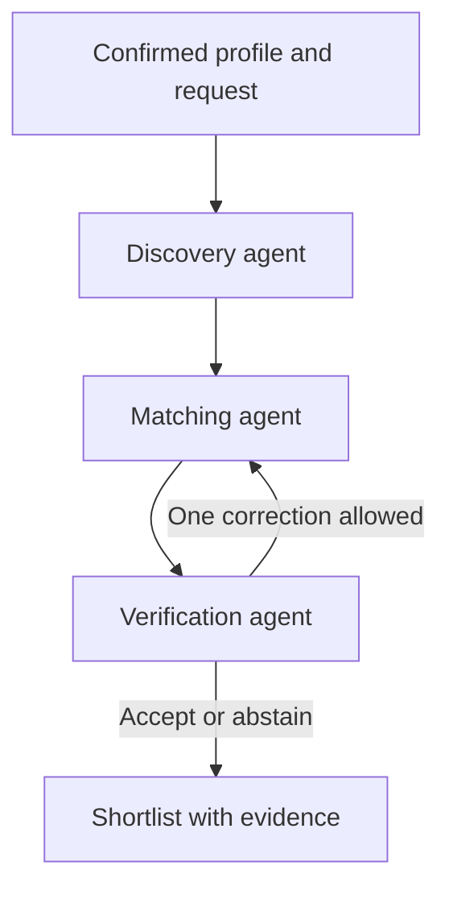

# CareerMatch

### A multi-agent job-search assistant with evidence-backed recommendations

**Status: pre-implementation design.** This README specifies the intended four-day MVP. Application code, deployment, user adoption, and evaluation results are not yet established. Features below are planned unless explicitly marked complete. Update the status table as the implementation is verified.

CareerMatch is designed to turn a résumé and a conversation about preferences into a small, explainable shortlist of jobs. Each recommendation should distinguish supported matches, missing requirements, and unknown information. The assistant should remember explicit preference changes across sessions.

## Why this project

A title match is not enough to make a job suitable. A listing can mention Python and AI yet require several years of experience, exclude the candidate's country, or require a completed degree. Résumés can also omit recently learned skills.

This project explores three engineering questions:

1. Can retrieval combine semantic relevance with strict eligibility constraints?
2. Can specialized agents explain matches without inventing candidate qualifications or job requirements?
3. Does a multi-agent workflow improve quality enough to justify its additional latency and cost?

The aim is a small, measurable system. It is not a claim of production-scale search or guaranteed job suitability.

## Example user journey

1. Upload a text-based PDF résumé.
2. Specify target roles, available locations, work mode, and any hard constraints.
3. Add facts absent from the résumé, such as recently completed multi-agent AI learning.
4. Review extracted preferences and candidate facts before saving them.
5. Request a shortlist of up to five jobs.
6. Inspect the evidence, gaps, and uncertainty for each recommendation.
7. Change a preference, begin another session, and confirm that subsequent searches use the update.

Example request:

> Find AI engineering internships. I know Python and RAG, and I have recently learned multi-agent AI. I can work remotely from India or on-site in Bengaluru. Exclude jobs that require graduation to be completed.

Illustrative response structure — not a real listing or measured result:

- **Fit:** the role mentions Python and document retrieval; the candidate's PDF RAG project supports related experience.
- **Gap:** production SQL experience is not established by the supplied evidence.
- **Eligibility:** student eligibility is explicitly stated in the listing.
- **Work mode:** remote work from India is explicitly supported.
- **Sources:** listing excerpt and candidate evidence identifiers.
- **Freshness:** timestamp of the saved listing; live availability not checked.

The system may return fewer than five results or no confirmed matches.

## MVP status and scope

All implementation items begin unchecked.

| Component | Four-day MVP scope | Status |
| --- | --- | --- |
| Candidate ingestion | Text-based PDF parsing and schema-validated profile extraction | Planned |
| Job corpus | Target of 100–300 listings with source URLs and capture dates | Planned |
| Retrieval | PostgreSQL text search plus embedding similarity | Planned |
| Eligibility | Deterministic hard filters with pass, fail, and unknown outcomes | Planned |
| Agents | Discovery, matching, and verification with bounded tool access | Planned |
| Memory | Explicit candidate preferences persisted in SQL | Planned |
| Backend | FastAPI endpoints and validated request/response schemas | Planned |
| Interface | Simple Gradio upload, search, preference, and result views | Planned |
| Evaluation | 20–30 reviewed scenarios and a held-out subset | Planned |
| Packaging | Docker Compose, environment example, repeatable setup | Planned |

### Deferred beyond the MVP

- Broad crawling, continuous refresh, and claims of live availability.
- Automatic job applications or sending messages.
- Résumé rewriting.
- OCR and complex document layouts.
- Fine-tuned models or a learned recommender trained on user behavior.
- Large-scale distributed search.
- Open-ended agent delegation.
- Production authentication, billing, and multi-tenant operations.

The initial corpus is a dated snapshot. A small update fixture should test replacing one changed listing and excluding one closed listing; this is not a continuous ingestion service.

## Proposed architecture

The orchestration layer controls sequencing, retries, and budgets. Agents receive only the tools needed for their task.



The three agents share a typed state containing a profile version, preference version, retrieved job identifiers, match assessments, verification outcomes, and execution metadata. They do not pass an unbounded transcript as the only source of state.

### Components

| Component | Proposed responsibility |
| --- | --- |
| FastAPI | Input validation, endpoint handling, errors, run identifiers |
| LangGraph | Bounded workflow, routing, tool use, correction state |
| PostgreSQL | Jobs, candidate evidence, preferences, runs, feedback |
| pgvector | Embedding storage and similarity retrieval |
| PostgreSQL text search | Lexical retrieval for precise terms and titles |
| Pydantic | Agent outputs, tool arguments, API contracts |
| SQLAlchemy | Database access and schema management |
| Gemini provider integration | Initial chat and embedding provider, selected during implementation |
| Gradio | Minimal reviewer-facing interface |
| Docker Compose | Local API and database startup |
| pytest | Constraint, persistence, retrieval, and workflow tests |

Record exact dependency and model versions after a clean-environment setup succeeds. Model identifiers, embedding dimensions, and provider limits must be checked during implementation.

## Agent responsibilities

### 1. Discovery agent

**Goal:** turn the user's confirmed goals into useful searches and select a candidate pool.

Proposed tools:

- `get_preferences(profile_id)`
- `search_jobs(query, filters, limit)`
- `get_job_details(job_id)`

The agent may broaden wording or try another query when results are sparse. It must not silently relax hard constraints. It should return job identifiers and search rationale, not final claims of eligibility.

### 2. Matching agent

**Goal:** compare a bounded set of retrieved jobs against the candidate's evidence.

Proposed tools:

- `get_candidate_evidence(profile_id, evidence_ids)`
- `get_job_details(job_id)`
- `get_source_excerpt(source_id, excerpt_id)`

For each job, return supported matches, gaps, unknowns, and evidence references. Distinguish required qualifications from preferred qualifications. Treat unrelated experience as transferable only when the explanation says why.

### 3. Verification agent

**Goal:** review the proposed explanation against the actual evidence and deterministic constraint results.

Proposed tools:

- `get_source_excerpt(source_id, excerpt_id)`
- `check_constraints(profile_id, job_id)`
- `get_listing_metadata(job_id)`

Allowed outcomes:

- `accept`: explanation is supported and the job passes required eligibility checks.
- `revise`: an explanation can be corrected using available evidence.
- `reject`: a known hard constraint fails.
- `needs_review`: an essential fact is unavailable or contradictory.

The verifier is another fallible model. It supplements validation and human evaluation; it does not establish truth on its own.

### Orchestration limits

Initial configuration targets, to be adjusted after measurement:

- No more than two discovery searches.
- Match at most ten retrieved jobs per run.
- Return at most five accepted recommendations.
- One correction pass after verification.
- Up to two retries for transient provider failures.
- A configurable overall timeout and total model-call budget.
- Stop with an explicit partial or failed result when the budget is exhausted.

Do not allow retries at multiple layers to multiply without a shared budget.

## Candidate evidence and memory

### Provenance is part of the data

A candidate statement, a résumé claim, and an inspected artifact are different evidence sources. Preserve the distinction.

Proposed evidence categories:

| Category | Meaning |
| --- | --- |
| `resume_statement` | Appears in a supplied résumé; not independently verified |
| `user_statement` | Explicitly supplied by the candidate |
| `artifact_excerpt` | Supported by a supplied project or document excerpt |
| `not_established` | Available inputs do not establish the claim |

An artifact excerpt should only be stored when the relevant content has actually been provided or retrieved. The MVP does not autonomously audit an entire GitHub profile.

Illustrative evidence record:

```json
{
  "evidence_id": "ev_003",
  "skill": "multi-agent AI",
  "source_type": "user_statement",
  "source_excerpt": "I recently learned multi-agent AI.",
  "source_id": "candidate_message_003",
  "verification_status": "self_reported"
}
```

The assistant should not turn this into a claim that the candidate deployed production agent systems. Equally, it should not discard the skill just because the résumé does not mention it.

### Preference updates

Store hard constraints and soft preferences separately. Persist confirmed updates with timestamps and a version number.

Example:

- Previous: Bengaluru on-site or remote from India.
- Update: remote from India only.
- Result: future searches use the new preference version.
- Historical runs retain the old version for reproducibility.

Search results should not silently mutate the candidate's preferences. Request-specific filters should not become permanent preferences without confirmation.

## Data model

Proposed entities:

| Entity | Important fields |
| --- | --- |
| Candidate profile | ID, résumé reference, extracted facts, profile version |
| Evidence | Profile ID, claim, source type, source excerpt, source ID |
| Preference | Profile ID, field, value, hard/soft status, version, updated time |
| Job | ID, source URL, title, company, description, normalized constraints |
| Job metadata | Capture time, content hash, source status, deduplication key |
| Job embedding | Job ID, model ID, dimension, content hash, vector |
| Search run | Profile/preference versions, query, configuration, timestamps |
| Match | Run ID, job ID, rank, evidence references, gaps, unknowns, decision |
| Trace | Agent name, tool name, duration, outcome, token/cost metadata |
| Feedback | Run ID, job ID, relevant/not relevant, reason |

For the local MVP, use isolated seeded profiles rather than pretending a client-provided profile ID is authentication. All queries must still scope profile-owned records correctly. Do not expose real user résumés on a public demo before access controls exist.

## Job corpus and ingestion

Start with a reproducible snapshot of 100–300 listings. Keep a source manifest. If sample data is synthetic, label it as synthetic and exclude it from claims about real job coverage.

Ingestion should:

1. Validate required fields and preserve the original source text.
2. Normalize title, location, work mode, employment type, experience, and education requirements.
3. Store evidence excerpts for extracted constraints.
4. Mark absent or ambiguous fields as unknown.
5. Deduplicate using source identifiers and normalized URLs.
6. Calculate a content hash.
7. Embed new or changed content only.
8. Update the searchable version atomically.
9. Exclude explicitly closed jobs.
10. Retain the capture date and freshness limitation in outputs.

A listing failing to load is not proof that it is closed. A saved snapshot is not proof that it remains open.

## Retrieval and ranking

### Retrieval plan

1. Apply explicit filters for known hard constraints.
2. Retrieve candidates through text search and embedding similarity.
3. Combine candidate lists using a documented rank-fusion method.
4. Deduplicate by job ID.
5. Pass the bounded candidate pool to the matching stage.
6. Apply deterministic eligibility gates again before final output.

Use rank-based fusion initially rather than adding uncalibrated lexical and vector scores directly. Record the method and its parameters.

### Eligibility policy

Every hard requirement should resolve to `pass`, `fail`, or `unknown`.

- A known failure excludes a job from the accepted shortlist.
- An unknown essential requirement appears in a separate needs-review category.
- A high semantic score cannot override a failure.
- “Remote” does not establish worldwide or India-based eligibility.
- “Degree preferred” and “degree required” are different.
- Missing evidence about a candidate is not proof of missing ability.
- Do not fill the shortlist with weak matches merely to reach five results.

### Match quality

Initial ranking may combine retrieval rank, supported skills, experience compatibility, and soft preferences through documented rules. Keep it separate from strict eligibility.

If a numerical score is shown, label it as an internal ranking score. It is not a probability of getting hired, a calibrated suitability percentage, or a third-party ATS score.

## Structured output contract

Illustrative contract, to be implemented and validated:

```json
{
  "job_id": "job_042",
  "decision": "needs_review",
  "supported_matches": [
    {
      "requirement": "Experience with retrieval pipelines",
      "candidate_evidence_ids": ["ev_007"],
      "job_excerpt_ids": ["job_042_excerpt_2"],
      "explanation": "The supplied project excerpt describes PDF chunking and vector retrieval."
    }
  ],
  "gaps": ["Production SQL experience is not established by the supplied evidence."],
  "unknowns": ["The listing does not state whether current students are eligible."],
  "constraint_checks": [
    {
      "field": "student_eligibility",
      "result": "unknown",
      "source_excerpt_ids": []
    }
  ]
}
```

Validate both schema shape and referential integrity. Evidence IDs must belong to the current profile, and job excerpts must belong to the referenced listing. Reject unsupported source identifiers rather than rendering fabricated citations.

## Proposed API contract

These routes are a design target; they are not available yet.

| Method | Route | Purpose |
| --- | --- | --- |
| POST | `/profiles` | Upload and parse a résumé into a draft profile |
| POST | `/profiles/{id}/confirm` | Confirm extracted facts and preferences |
| PATCH | `/profiles/{id}/preferences` | Persist an explicit preference update |
| POST | `/searches` | Start a bounded matching run |
| GET | `/searches/{id}` | Return status, shortlist, unknowns, and failure details |
| GET | `/searches/{id}/trace` | Return a redacted inspection trace |
| POST | `/feedback` | Record match feedback for later review |
| GET | `/health` | Report process health |
| GET | `/ready` | Check required database/index readiness |

For the MVP, a short synchronous search request with a hard timeout is acceptable. A durable background queue is a later extension. Clearly distinguish complete, partial, and failed runs.

## Proposed repository layout

The following paths are planned, not existing implementation files.

| Path | Contents |
| --- | --- |
| `app/api/` | Routes, request validation, errors |
| `app/agents/` | Discovery, matching, verification, orchestration |
| `app/services/` | Ingestion, extraction, retrieval, constraint evaluation |
| `app/db/` | Models, queries, migrations |
| `app/schemas/` | API, evidence, tool, and agent contracts |
| `app/ui/` | Gradio interface |
| `data/manifests/` | Listing sources and capture metadata |
| `data/fixtures/` | Sanitized test jobs and sample profiles |
| `evals/` | Cases, labels, evaluation runner, result summaries |
| `tests/` | Unit and integration tests |
| `docs/` | Architecture decisions and measured limitations |
| `compose.yaml` | Local API/database configuration |
| `.env.example` | Variable names without credentials |
| `pyproject.toml` | Tested dependency declarations |

## Setup status

There is no runnable setup yet. Once implementation exists, replace this section with commands that were successfully tested from a fresh clone.

Setup must cover:

- Supported Python version and locked dependencies.
- Database startup and schema migration.
- Required chat and embedding provider settings.
- Embedding dimensions matching the database vector schema.
- Fixture ingestion and initial index creation.
- API and interface startup.
- Tests and evaluation commands.
- Expected first-run output and common failure messages.

Do not publish installation commands pointing to files that have not been created.

## Evaluation plan

### Dataset

Create 20–30 human-reviewed scenarios across multiple candidate profiles and preference combinations. Include ordinary successes and adversarial edge cases.

Separate development cases from held-out cases before tuning. Save corpus, prompt, model, and code versions with each result.

### Baselines

Compare:

1. Hybrid retrieval plus deterministic filters.
2. A single agent using the same tools and evidence.
3. The three-agent workflow.

Keep the corpus, candidate profiles, and evaluation labels constant. Report the budget used by each system. Do not assume multiple agents will win.

### Metrics

| Metric | Definition |
| --- | --- |
| Relevant@5 | Number of relevant jobs among the first five positions, divided by five |
| Returned precision | Relevant returned jobs divided by jobs returned; report no-result cases separately |
| Hard-constraint violation rate | Accepted jobs violating a known hard constraint divided by accepted jobs |
| Unsupported-claim rate | Unsupported factual claims divided by reviewed factual claims |
| Unknown handling | Cases where missing critical information is correctly preserved as unknown |
| Memory correctness | Preference-change scenarios producing the expected subsequent filtering |
| Coverage and abstention | Fraction of scenarios with accepted results, plus cases where no result is correct |
| Latency | End-to-end median and p95 with the number of measured runs |
| Cost | Observed provider usage and cost per run, or clearly labeled estimates |

Report numerators and denominators for small samples. For example, “0 violations among 45 accepted recommendations in this test set” is more precise than “100% accurate.” If Relevant@5 penalizes a correct no-match case, report those cases separately.

An LLM judge may assist annotation, but a second model agreeing with the first is not sufficient evidence of factual correctness. Inspect the source material.

### Required cases

- A relevant AI role requiring more experience than the candidate has.
- A remote job restricted to another country.
- A listing with no graduation policy.
- A preferred qualification incorrectly interpreted as required.
- A closed listing and a duplicate listing.
- A recently learned skill present only in a user statement.
- A changed preference surviving a process restart.
- Conflicting source information.
- Malformed model output and nonexistent evidence IDs.
- Tool timeout and provider failure.
- Instructions embedded in a job description that must remain untrusted content.
- A scenario where returning no accepted jobs is the correct answer.

### Results

**Not measured.** No performance, latency, cost, or user-adoption claims are available at this stage.

| System | Cases evaluated | Relevant@5 | Constraint violations | Unsupported claims | Latency | Cost |
| --- | --- | --- | --- | --- | --- | --- |
| Retrieval baseline | Not run | — | — | — | — | — | — |
| Single agent | Not run | — | — | — | — | — | — |
| Three agents | Not run | — | — | — | — | — | — |

## Reliability and data handling

The MVP should include timeouts, capped retries, schema validation, deterministic gates, structured errors, and request IDs. Do not fabricate fallback matches when a provider fails.

Treat résumé and job text as data, not system instructions. Keep credentials out of source control and logs. Redact résumé content from shared traces. Use synthetic or consenting test profiles in demos.

A local prototype is not a secure public multi-user service. If public hosting is added during the four days, restrict it to safe sample data unless authentication, ownership checks, upload limits, and deletion behavior are implemented and tested.

## Four-day implementation plan

### Day 1: retrieval foundation

- [ ] Create backend and database skeleton.
- [ ] Ingest the initial job snapshot with source metadata.
- [ ] Parse one sample résumé into a validated draft profile.
- [ ] Implement lexical/vector retrieval and deterministic filters.
- [ ] Run a search without agents.

**Exit condition:** a repeatable command or endpoint retrieves relevant jobs and respects known hard constraints.

### Day 2: agent workflow and memory

- [ ] Implement tool contracts and the three agent roles.
- [ ] Add evidence-backed output schemas.
- [ ] Persist confirmed preferences and versions.
- [ ] Add bounded correction and failure paths.
- [ ] Verify an end-to-end shortlist.

**Exit condition:** the same request yields traceable recommendations with explicit gaps and unknowns.

### Day 3: evaluation and repairs

- [ ] Create reviewed evaluation cases and a held-out subset.
- [ ] Run the retrieval and single-agent baselines.
- [ ] Run the multi-agent workflow.
- [ ] Correct observed filtering, memory, and evidence failures.
- [ ] Record actual results and remaining limitations.

**Exit condition:** a reader can inspect measured behavior, including failures, rather than rely on demonstration screenshots.

### Day 4: packaging and presentation

- [ ] Add the simple interface and trace view.
- [ ] Test installation in a fresh environment.
- [ ] Finish Docker configuration if stable.
- [ ] Record a three-minute demonstration.
- [ ] Replace planned README statements with verified implementation facts.
- [ ] Add only completed capabilities to the résumé.

**Exit condition:** a reviewer can reproduce a sample run and understand the implementation and its limits.

If behind schedule, reduce corpus size and interface polish first. Preserve one complete workflow, correct constraints, and evaluation.

## Demonstration script

1. Load a sample résumé and add one self-reported skill.
2. Request suitable internships.
3. Open one recommendation and its source excerpts.
4. Show a tempting job rejected for a genuine constraint.
5. Show an uncertain requirement remaining uncertain.
6. Change a preference and demonstrate persistence in a new session.
7. Open the evaluation report and explain one failure that was fixed.

## Definition of done

- [ ] Fresh setup works using the documented instructions.
- [ ] The corpus size and capture date are reported accurately.
- [ ] Repeated searches reuse unchanged embeddings.
- [ ] Accepted results pass deterministic gates.
- [ ] Evidence references resolve to the correct profile and job.
- [ ] Unknown information remains visible.
- [ ] Preference changes persist and affect later searches.
- [ ] Tool errors produce clear partial/failure outcomes.
- [ ] At least one simpler baseline has been evaluated.
- [ ] Results include sample sizes and limitations.
- [ ] The README clearly separates completed and deferred capabilities.
- [ ] No résumé bullet claims an unimplemented feature or invented metric.

## Development approach

AI coding assistants may be used for implementation and debugging. The maintainer should review the generated code, make the design decisions explicit, inspect data flow, and validate behavior with tests and evaluation. Record specific contributions and fixes in the commit history.

## Motivation and references

This is an independent learning project inspired by career-search problems. It is not affiliated with Elip and does not claim to reproduce its internal architecture.

Its focus aligns with the agent, retrieval, and backend responsibilities in [Elip's Software Engineer internship listing](https://dashboard.tryelip.ai/jobs/PsnWr). Elip's [public product description](https://tryelip.ai/) also discusses remembered preferences and explained matches. These sources informed the problem choice; the design above is proposed independently.

Maintainer: [Arjun Singh / triumphkin](https://github.com/triumphkin).

